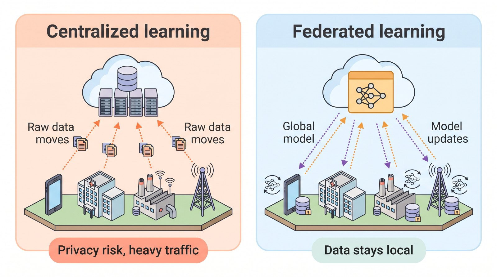
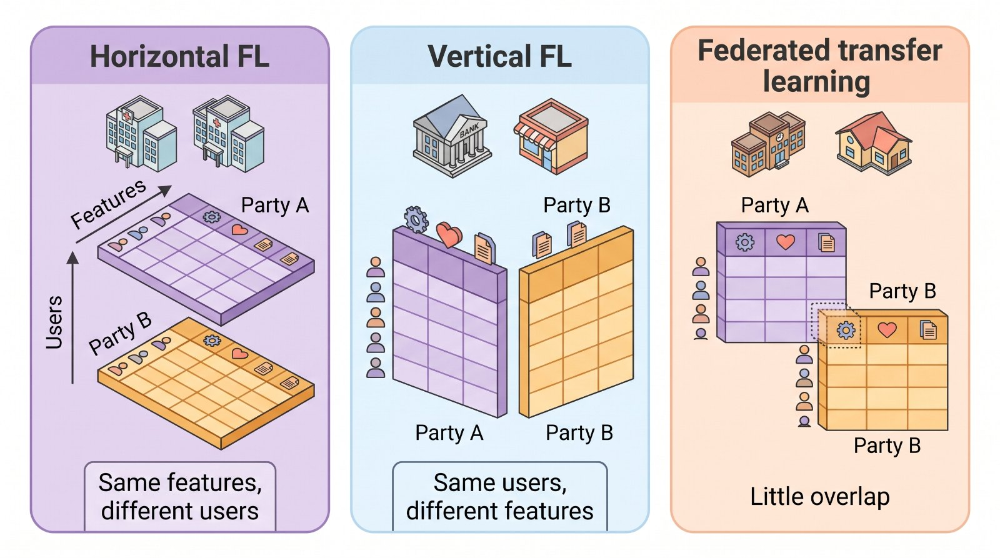

The data that would make our models better is often the data we cannot collect. Messages typed on phones. Scans in hospital archives. Traffic logs inside operator networks. Images taken on board satellites. Federated learning (FL) is a way to learn from this data without moving it.

This post opens the series *Federated learning, challenge by challenge*. It explains the idea, walks through one training round, sorts the main kinds of FL, and maps the seven challenges that the next posts take on, one at a time.

## Move the model, not the data

In classic machine learning, the data goes to the model. Every phone, hospital or sensor uploads its data to one server, and the server trains. Federated learning reverses the direction. The server sends the model to where the data lives. Each client trains it locally and sends back only an update. The server combines the updates into a better model, and the cycle repeats. McMahan et al. at Google coined the term in 2016 and proposed the algorithm that most systems still start from [1].

 

Why not simply collect the data? There are four common reasons.

- **Privacy and regulation.** Personal and medical data is protected by law, for example by the European Union's General Data Protection Regulation (GDPR), which asks for data minimization. In FL, raw data never leaves the place where it was produced.
- **Volume.** Some data is too large to move. A model of a few megabytes is cheaper to send than terabytes of video, network traces or satellite images.
- **Ownership.** Hospitals, banks and network operators rarely share data with each other. They may still agree to train a model together.
- **Connectivity.** Some clients are reachable only now and then. A satellite in low Earth orbit (LEO) can talk to a ground station only during short contact windows. These windows are too short to download everything the satellite captures, but long enough to send a model update [2].

FL already runs in products and in large studies. Google trained the next-word prediction model of its Gboard keyboard on users' phones with FL, and the federated model predicted better than the one trained on the server [3]. In medicine, 71 sites on six continents trained a brain tumor segmentation model together, on data from 6,314 patients, sharing only model updates [4].

One warning before going further: FL is not private by default. The updates still carry information about the data. Researchers have rebuilt training images from shared gradients [5]. Real systems add secure aggregation, so that the server only sees the sum of the updates [6], and differential privacy, which adds calibrated noise to them [7]. Part 6 of this series is about this gap.

## One round, step by step

Most FL systems run some version of federated averaging (FedAvg) [1]. One training round has four steps.

1. **Broadcast.** The server picks a fraction of the clients and sends them the current global model.
2. **Local training.** Each selected client trains the model on its own data, for a few epochs of stochastic gradient descent (SGD).
3. **Upload.** Each client sends back its new model weights. Its data stays where it is.
4. **Aggregate.** The server averages the weights it received. Each client counts in proportion to its amount of data:

$$
w_{t+1} = \sum_{k \in S_t} \frac{n_k}{m_t}\, w_{t+1}^k, \qquad m_t = \sum_{k \in S_t} n_k
$$

Here $S_t$ is the set of clients selected in round $t$, $n_k$ is the number of examples on client $k$, and $w_{t+1}^k$ is the model that client $k$ sends back. The next round starts from $w_{t+1}$. A full training run takes hundreds or thousands of rounds.

Step 2 is the heart of the method. In the simplest alternative, federated SGD (FedSGD), each client computes a single gradient per round. FedAvg lets each client make many local updates before it communicates. McMahan et al. showed that this cuts the number of communication rounds by 10 to 100 times compared with synchronized SGD [1]. Averaging works because every client starts each round from the same model, so the local models stay close to each other. When the clients' data differ a lot, they drift apart. That is the first challenge below.

## Who the clients are: cross-device and cross-silo

Kairouz et al. distinguish two settings [8]. Cross-device FL runs on phones and Internet of Things (IoT) devices. Cross-silo FL runs across organizations. They lead to very different systems.

| | Cross-device FL | Cross-silo FL |
|---|---|---|
| Clients | Phones, wearables, IoT devices | Hospitals, banks, operators |
| Scale | Up to billions of devices | Typically 2 to 100 organizations |
| Availability | Only a fraction online at any time | Almost always available |
| Reliability | 5% or more may drop out of a round | Few failures |
| Participation | A client takes part once or rarely | A client can join every round |
| Main bottleneck | Communication | Computation or communication |
| Data split | By examples (horizontal) | Horizontal or vertical |

Gboard is cross-device. The tumor study is cross-silo. A satellite constellation sits in between: tens to thousands of clients, each with a lot of data, reachable only at predictable times.

## How the data is split: horizontal, vertical, transfer

Yang et al. sort FL by how the data is split between the parties [9].

 

- **Horizontal FL.** The parties hold the same kind of data about different people. Two hospitals keep the same type of records for different patients. This is the most common case, and the focus of this series.
- **Vertical FL.** The parties hold different data about the same people. A bank and an online shop share many customers but record different things about them. They first find their common users without revealing anyone else, then train a model that is split between them.
- **Federated transfer learning.** The parties share few users and few features. Transfer learning bridges the gap.

## Who coordinates: three architectures

- **Centralized.** One server talks to all clients. This is the classic design and the easiest to run. But the server is a single point of failure, a bottleneck, and a party that everyone must trust.
- **Hierarchical.** Edge servers aggregate the clients near them, and the cloud aggregates the edge servers. Base stations, gateways and ground stations can play the edge role. Aggregating close to the clients cuts long-distance traffic, which suits mobile networks and satellite constellations. A satellite with no ground station in view can even relay its update to a neighbor over an inter-satellite link [2].
- **Decentralized.** There is no server. Each client averages its model with its neighbors, and agreement spreads through the network [10]. Nobody has to be trusted with everything. In exchange, agreement takes longer, and a misbehaving client is harder to spot.

## Where it breaks: seven challenges

The loop above looks simple. In practice, each step can go wrong. Here are the seven challenges this series covers, one post each.

**1. Non-IID data (Part 2).** The clients' data are not independent and identically distributed (IID). One phone holds mostly photos of cats, another mostly photos of food. Local models drift toward their own data, and their average learns slowly or settles on a worse model. Proposed fixes correct this drift, for example FedProx, which keeps local models close to the global one [11], and SCAFFOLD, which estimates and removes the drift with control variates [12].

**2. Communication cost (Part 3).** Models are large, and uplinks are slow and expensive. The fixes send fewer updates, with more local work or fewer clients per round, or smaller ones, through quantization [13] and sparsification.

**3. Slow and missing clients (Part 4).** Devices differ in speed, battery and connection. In a synchronous round, everyone waits for the slowest client, and some clients never answer. The fixes select clients that can finish before a deadline [14], or aggregate asynchronously, as updates arrive [15].

**4. One model does not fit everyone (Part 5).** The global model fits the average client. A client far from the average gets poor results. Personalized FL learns a shared model plus a version adapted to each client, as in Ditto [16], or groups similar clients and trains one model per group [17].

**5. Privacy: what updates can leak (Part 6).** As seen above, gradients can reveal training data [5]. The defenses are secure aggregation [6], differential privacy [7] and trusted hardware. Each one costs accuracy, computation, or both.

**6. Security: poisoned updates (Part 7).** A malicious client can send a crafted update that degrades the model, or that plants a backdoor firing on inputs of its choice [18]. Robust aggregation rules, such as Krum [19] or the coordinate-wise median [20], try to ignore the outliers.

**7. A client leaves: federated unlearning (Part 8).** Under the GDPR, people can ask for their data to be erased. In FL, a client's data is mixed into every later version of the model. Retraining from scratch is expensive, so methods such as FedEraser rebuild the model from stored past updates instead [21].

These challenges pull against each other. Secure aggregation hides each update from the server, which is good for privacy, but it also hides poisoned updates [18]. Robust aggregation drops unusual updates, but with non-IID data, honest clients look unusual too [16]. This tension is what makes FL hard, and why each post in this series weighs the trade-offs instead of only listing the fixes.

## What to remember

> **Key takeaways**
>
> - Federated learning moves the model to the data. Only model updates travel.
> - One round has four steps: broadcast, local training, upload, weighted averaging. Local training is what saves communication.
> - Cross-device and cross-silo FL are different worlds: millions of unreliable phones, or a few reliable organizations.
> - FL is not private by default. Updates can leak data, and secure aggregation and differential privacy close only part of the gap.
> - Seven challenges separate the simple loop from a working system: non-IID data, communication, slow clients, personalization, privacy, security and unlearning. The next posts take them one by one.

## Going further

For a broad view of the field, two surveys are good starting points: Kairouz et al. [8] and Li et al. [22].

## References

1. H. B. McMahan, E. Moore, D. Ramage, S. Hampson, and B. Agüera y Arcas, "Communication-efficient learning of deep networks from decentralized data," in *Proc. AISTATS*, 2017. [arXiv:1602.05629](https://arxiv.org/abs/1602.05629)
2. Z. Lin, Z. Wang, Y. Zhang, Y. Wang, O. Aouedi, Z. Fang, J. Xu, J. Yang, V. N. Ha, Y. Liu, M.-S. Alouini, and S. Chatzinotas, "Satellite intelligence: distributed training, collaborative inference, and LLM adaptation in LEO constellations," preprint, 2026.
3. A. Hard, K. Rao, R. Mathews, S. Ramaswamy, F. Beaufays, S. Augenstein, H. Eichner, C. Kiddon, and D. Ramage, "Federated learning for mobile keyboard prediction," 2018. [arXiv:1811.03604](https://arxiv.org/abs/1811.03604)
4. S. Pati et al., "Federated learning enables big data for rare cancer boundary detection," *Nature Communications*, vol. 13, art. 7346, 2022. [doi:10.1038/s41467-022-33407-5](https://doi.org/10.1038/s41467-022-33407-5)
5. L. Zhu, Z. Liu, and S. Han, "Deep leakage from gradients," in *Proc. NeurIPS*, 2019. [arXiv:1906.08935](https://arxiv.org/abs/1906.08935)
6. K. Bonawitz et al., "Practical secure aggregation for privacy-preserving machine learning," in *Proc. ACM CCS*, 2017. [Google Research](https://research.google/pubs/pub47246/)
7. H. B. McMahan, D. Ramage, K. Talwar, and L. Zhang, "Learning differentially private recurrent language models," in *Proc. ICLR*, 2018. [arXiv:1710.06963](https://arxiv.org/abs/1710.06963)
8. P. Kairouz, H. B. McMahan, et al., "Advances and open problems in federated learning," *Foundations and Trends in Machine Learning*, vol. 14, no. 1–2, 2021. [arXiv:1912.04977](https://arxiv.org/abs/1912.04977)
9. Q. Yang, Y. Liu, T. Chen, and Y. Tong, "Federated machine learning: concept and applications," *ACM Transactions on Intelligent Systems and Technology*, vol. 10, no. 2, 2019. [arXiv:1902.04885](https://arxiv.org/abs/1902.04885)
10. X. Lian, C. Zhang, H. Zhang, C.-J. Hsieh, W. Zhang, and J. Liu, "Can decentralized algorithms outperform centralized algorithms? A case study for decentralized parallel stochastic gradient descent," in *Proc. NeurIPS*, 2017. [arXiv:1705.09056](https://arxiv.org/abs/1705.09056)
11. T. Li, A. K. Sahu, M. Zaheer, M. Sanjabi, A. Talwalkar, and V. Smith, "Federated optimization in heterogeneous networks," in *Proc. MLSys*, 2020. [arXiv:1812.06127](https://arxiv.org/abs/1812.06127)
12. S. P. Karimireddy, S. Kale, M. Mohri, S. Reddi, S. Stich, and A. T. Suresh, "SCAFFOLD: Stochastic controlled averaging for federated learning," in *Proc. ICML*, 2020. [arXiv:1910.06378](https://arxiv.org/abs/1910.06378)
13. D. Alistarh, D. Grubic, J. Li, R. Tomioka, and M. Vojnovic, "QSGD: Communication-efficient SGD via gradient quantization and encoding," in *Proc. NeurIPS*, 2017. [arXiv:1610.02132](https://arxiv.org/abs/1610.02132)
14. T. Nishio and R. Yonetani, "Client selection for federated learning with heterogeneous resources in mobile edge," in *Proc. IEEE ICC*, 2019. [arXiv:1804.08333](https://arxiv.org/abs/1804.08333)
15. J. Nguyen, K. Malik, H. Zhan, A. Yousefpour, M. Rabbat, M. Malek, and D. Huba, "Federated learning with buffered asynchronous aggregation," in *Proc. AISTATS*, 2022. [arXiv:2106.06639](https://arxiv.org/abs/2106.06639)
16. T. Li, S. Hu, A. Beirami, and V. Smith, "Ditto: Fair and robust federated learning through personalization," in *Proc. ICML*, 2021. [arXiv:2012.04221](https://arxiv.org/abs/2012.04221)
17. F. Sattler, K.-R. Müller, and W. Samek, "Clustered federated learning: model-agnostic distributed multitask optimization under privacy constraints," *IEEE Transactions on Neural Networks and Learning Systems*, vol. 32, no. 8, 2021. [arXiv:1910.01991](https://arxiv.org/abs/1910.01991)
18. E. Bagdasaryan, A. Veit, Y. Hua, D. Estrin, and V. Shmatikov, "How to backdoor federated learning," in *Proc. AISTATS*, 2020. [arXiv:1807.00459](https://arxiv.org/abs/1807.00459)
19. P. Blanchard, E. M. El Mhamdi, R. Guerraoui, and J. Stainer, "Machine learning with adversaries: Byzantine tolerant gradient descent," in *Proc. NeurIPS*, 2017.
20. D. Yin, Y. Chen, K. Ramchandran, and P. Bartlett, "Byzantine-robust distributed learning: towards optimal statistical rates," in *Proc. ICML*, 2018. [arXiv:1803.01498](https://arxiv.org/abs/1803.01498)
21. G. Liu, X. Ma, Y. Yang, C. Wang, and J. Liu, "FedEraser: Enabling efficient client-level data removal from federated learning models," in *Proc. IEEE/ACM IWQoS*, 2021. [doi:10.1109/IWQOS52092.2021.9521274](https://doi.org/10.1109/IWQOS52092.2021.9521274)
22. T. Li, A. K. Sahu, A. Talwalkar, and V. Smith, "Federated learning: challenges, methods, and future directions," *IEEE Signal Processing Magazine*, vol. 37, no. 3, 2020. [arXiv:1908.07873](https://arxiv.org/abs/1908.07873)
